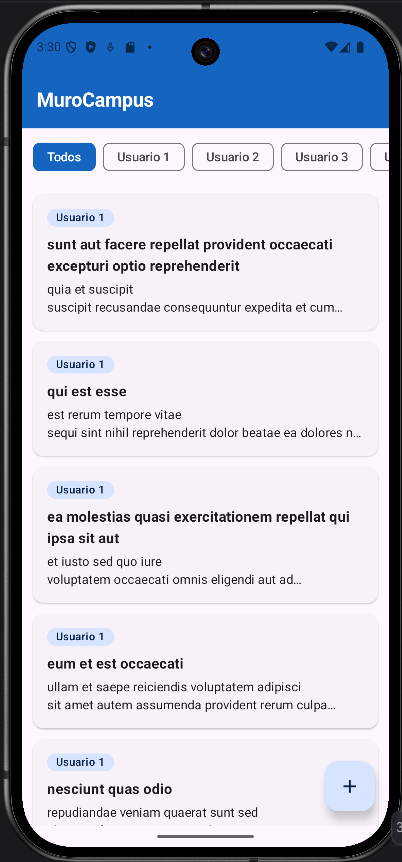
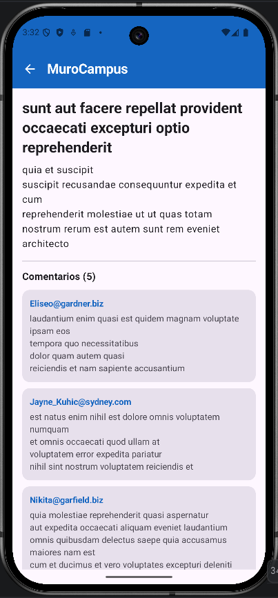
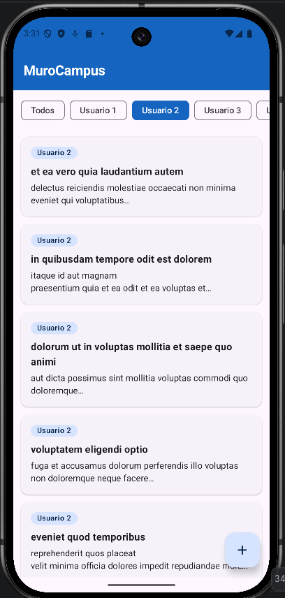
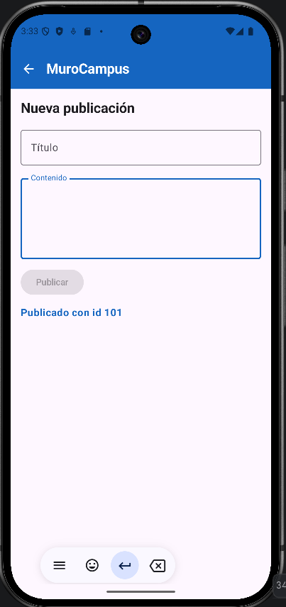

# MuroCampus

App Android que consume un **servicio web REST** (JSONPlaceholder) para mostrar un muro de publicaciones.
Hecha con **Kotlin + Jetpack Compose**, **Retrofit + OkHttp + kotlinx.serialization** y arquitectura **MVVM + Repository**.

**Alumno:** Piero Guevara · **Curso:** Programación en Móviles (4.º ciclo, TECSUP) · **Laboratorio 09:** Servicios web y plataforma REST

## ¿Qué hace?

- Lista las 100 publicaciones del servicio (`GET posts`).
- Muestra el detalle de una publicación con sus 5 comentarios (`GET posts/{id}` y `GET posts/{id}/comments`).
- Filtra por usuario con una fila de chips (`GET posts?userId=N`).
- Crea una publicación nueva (`POST posts` con `@Body`); JSONPlaceholder responde con el id 101, pero no guarda nada.
- Maneja los tres estados (Cargando, Éxito y Error) y se comporta bien sin internet, con el botón **Reintentar**.

## Estructura de paquetes

```
com.guevara.murocampus/
├── MainActivity.kt              Scaffold, barra superior y navegación sencilla
├── model/
│   └── Modelos.kt               Usuario, Post, Comentario, NuevoPost
├── data/
│   ├── remote/
│   │   ├── PostApi.kt           interface de Retrofit (@GET, @POST, @Path, @Query, @Body)
│   │   └── RetrofitClient.kt    cliente creado una sola vez (OkHttp + conversor JSON)
│   ├── MensajesError.kt         convierte una excepción en un mensaje para el usuario
│   └── PostRepository.kt        interface + PostRepositoryRemote (devuelve Result)
├── viewmodel/
│   ├── UiState.kt               Cargando / Exito / Error
│   ├── PostsViewModel.kt        lista, detalle, filtro y crear
│   └── PostsViewModelFactory.kt
└── ui/
    ├── Componentes.kt           TarjetaPost, Cargando, ErrorConReintento
    ├── PantallaLista.kt
    ├── PantallaDetalle.kt
    ├── PantallaCrear.kt
    └── theme/
```

## Arquitectura MVVM + Repository

```
View (PantallaLista, PantallaDetalle, PantallaCrear)
   |  eventos: cargar, filtrar, publicar          ^  collectAsStateWithLifecycle()
   v                                              |
ViewModel (PostsViewModel) ---- StateFlow<UiState> (Cargando / Exito / Error)
   |  viewModelScope.launch
   v
PostRepository (interface)  <- devuelve Result<...>
   |
   `-> PostRepositoryRemote  (captura IOException, HttpException...)
          |
          v
       PostApi (Retrofit) --- OkHttp ---> https://jsonplaceholder.typicode.com/
```

| Capa | Conoce a | No debe |
| --- | --- | --- |
| View (`ui/`) | Solo a su ViewModel | Llamar a Retrofit ni conocer `PostApi` |
| ViewModel | Solo a la interface `PostRepository` | Conocer Retrofit, `HttpException` ni `Context` |
| Repository | `PostApi` y las excepciones de red | Conocer la UI ni dejar escapar excepciones |
| `data/remote` | Retrofit, OkHttp y el JSON | Guardar estado de pantalla |

> La función `mensajeDe` (que traduce `HttpException` a texto) vive en `data/`, no en `viewmodel/`, para que el ViewModel no conozca ninguna clase de Retrofit.

## Capturas

| Lista                             | Detalle | Filtro |
|-----------------------------------| --- | --- |
|   |  |  |

| Crear                             |
|-----------------------------------|
|   |

## Cómo ejecutarla

1. Abrir la carpeta en Android Studio y esperar el **Sync**.
2. Ejecutar en un emulador con internet.
3. Para ver el log de las peticiones, filtrar Logcat por `OkHttp`.

