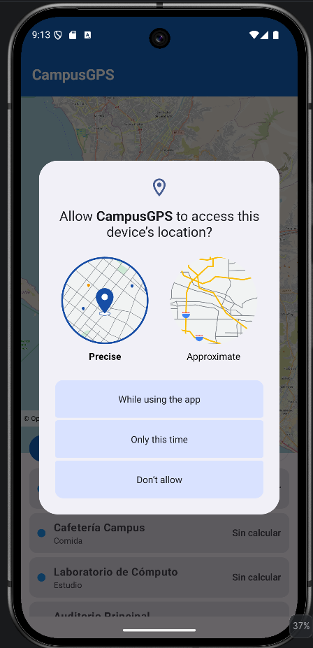
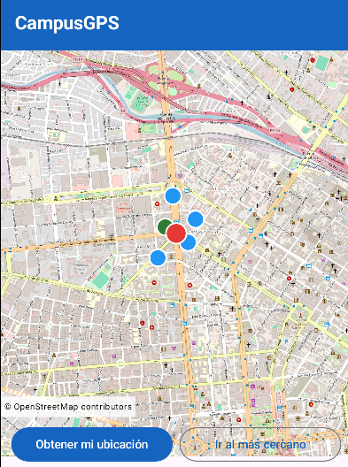
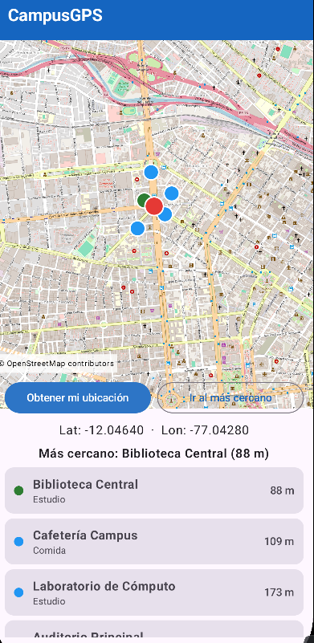
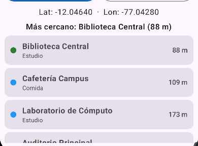
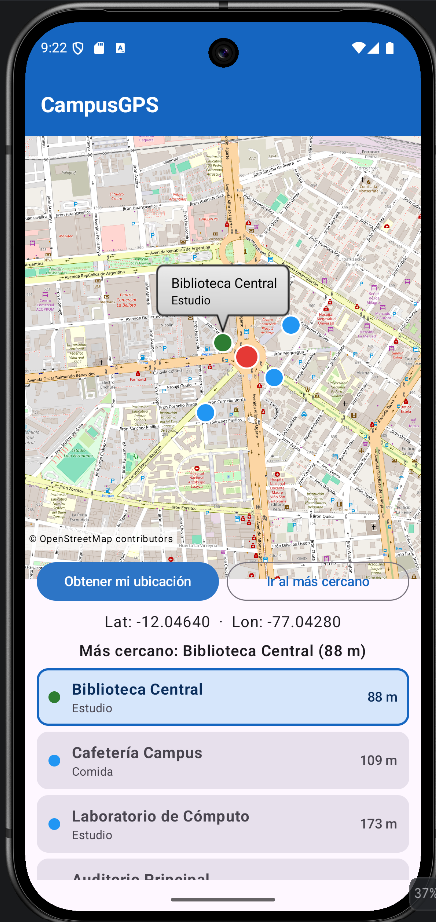

# CampusGPS

App Android que obtiene la ubicación del celular, la muestra en un mapa y te dice **qué lugar del campus tienes más cerca**. Muestra cinco puntos ficticios (biblioteca, cafetería, laboratorio, auditorio y estacionamiento) con su distancia en metros, ordenados del más cercano al más lejano.

- **Autor:** Piero Guevara
- **Curso:** Programación en Móviles · Laboratorio 13 · Localización Geográfica
- **Tecnología:** Kotlin + Jetpack Compose + Material 3, Google Play Services Location, osmdroid (OpenStreetMap)
- **Patrón:** MVVM + Repository (interface)

## Mapa

Esta versión usa **osmdroid (OpenStreetMap)**: no necesita clave de API ni cuenta de facturación. El `MapView` se integra en Compose con `AndroidView` (`MapaUbicacion.kt`). Solo necesita permiso de Internet (para bajar los mosaicos del mapa) y los permisos de ubicación.

## Estructura de paquetes

```
com.guevara.campusgps/
├── MainActivity.kt
├── model/
│   └── Modelos.kt                    Posicion, Lugar, LugarConDistancia, TipoError, UbicacionUi
├── data/
│   ├── UbicacionRepository.kt        interface
│   ├── UbicacionRepositoryGoogle.kt  implementación con FusedLocationProviderClient
│   ├── LugaresRepository.kt          interface
│   └── LugaresRepositoryLocal.kt     los 5 lugares fijos
├── util/
│   ├── Distancia.kt                  distanciaMetros()
│   └── Formato.kt                    formatearDistancia()
├── viewmodel/
│   ├── MapaViewModel.kt
│   └── CampusViewModelFactory.kt
└── ui/
    ├── PantallaMapa.kt
    ├── MapaUbicacion.kt
    ├── ListaLugares.kt
    ├── MensajeError.kt
    └── theme/
```

## Arquitectura MVVM + Repository

```
View (PantallaMapa)
   │  evento: pulsar el botón                    ▲
   ▼                                             │ collectAsState()
ViewModel (MapaViewModel) ───────── StateFlow ───┘
   │  llama a las interfaces
   ▼
UbicacionRepository ──► UbicacionRepositoryGoogle (FusedLocationProviderClient)
LugaresRepository   ──► LugaresRepositoryLocal    (los 5 lugares fijos)
```

| Capa | Conoce a | No debe |
| --- | --- | --- |
| View (`ui/`) | Solo a su ViewModel | Usar Repository, FusedLocationProviderClient ni calcular distancias |
| ViewModel | Solo a las interfaces de Repository | Conocer Composables ni recibir un Context |
| Repository | Google Play Services (en la implementación) | Exponer clases de UI |
| `util/` | Funciones puras (distancia, formato) | Guardar estado |

## Capturas

| 1. Permiso | 2. Mapa con mi ubicación | 3. Marcadores |
|--| --- | --- |
|  |  |  |

| 4. Lista ordenada | 5. Lugar más cercano                                    |
| -- |---------------------------------------------------------|
|  |  |

prueba

