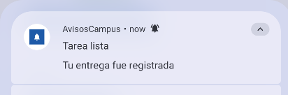
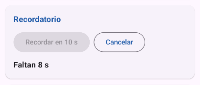
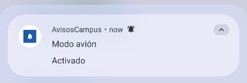
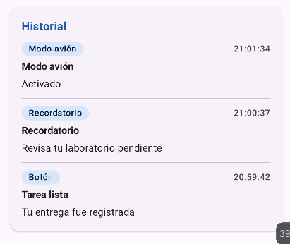
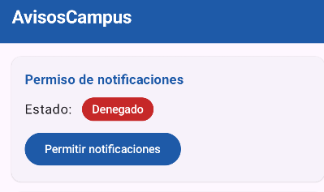

# AvisosCampus

App Android que **muestra notificaciones** y **escucha lo que pasa en el celular**. Con un botón muestra un aviso, con otro programa un recordatorio que llega a los 10 segundos y, si lo activas, te avisa cuando cambia el **modo avión**. Todo queda anotado en un historial.
Hecha con **Kotlin + Jetpack Compose + Material 3** (sin XML), notificaciones locales, corrutinas y `BroadcastReceiver`, con arquitectura **MVVM + Repository**.

**Alumno:** Piero Guevara · **Curso:** Programación en Móviles (4.º ciclo, TECSUP) · **Laboratorio 15:** Notificaciones

## ¿Qué hace?

- Crea el canal **Avisos** al iniciar la app y pide el permiso `POST_NOTIFICATIONS` (Android 13+), mostrando su estado: *Sin pedir*, *Permitido* o *Denegado*.
- **Mostrar aviso:** publica una notificación; al tocarla se abre la app y la notificación desaparece (`PendingIntent`).
- **Recordar en 10 s:** cuenta regresiva con una corrutina; se puede cancelar y sigue aunque rotes o minimices la app.
- **Escuchar el modo avión:** un `BroadcastReceiver` registrado solo mientras el switch está activo.
- **Historial** con los 20 avisos más recientes arriba, con su origen y su hora.
- Si el permiso está denegado, la app no se cierra: guarda el aviso en el historial, muestra un mensaje y ofrece **Abrir ajustes**.

## Estructura de paquetes

```
com.guevara.avisoscampus/
├── AvisosApp.kt                 Application: crea el canal al iniciar
├── MainActivity.kt              crea el ViewModel y muestra PantallaAvisos
├── model/
│   └── Modelos.kt               Aviso, Origen, PermisoUi
├── data/
│   └── AvisosRepository.kt      interface + AvisosRepositoryMemoria
├── notificacion/
│   └── Notificador.kt           canal, permiso y mostrar (lo único que toca el sistema)
├── receiver/
│   └── ModoAvionReceiver.kt     escucha ACTION_AIRPLANE_MODE_CHANGED
├── viewmodel/
│   ├── AvisosViewModel.kt       decide qué avisar y emite eventos
│   └── AvisosViewModelFactory.kt
└── ui/
    ├── PantallaAvisos.kt        las tarjetas: permiso, avisos, recordatorio, receptor
    ├── HistorialAvisos.kt       tarjeta del historial
    └── theme/
```

## Arquitectura MVVM + Repository

```
View (PantallaAvisos)
   |  eventos: botones, switch              ^  collectAsState()
   v                                        |
ViewModel (AvisosViewModel) --- StateFlow (avisos, permiso, faltan, escuchandoAvion, mensaje)
   |  registra el aviso
   |  emite: eventos (SharedFlow<Aviso>) ------> la View recibe el evento y llama a
   v                                              Notificador.mostrar(context, aviso)
AvisosRepository (interface)
   `-> AvisosRepositoryMemoria
```

| Capa | Conoce a | No debe |
| --- | --- | --- |
| View (`ui/`) | Solo a su ViewModel y al Notificador | Decidir qué se avisa ni guardar el historial |
| ViewModel | Solo a la interface del Repository | Conocer Composables, recibir un `Context` ni mostrar notificaciones |
| Repository | Nada de la UI | Usar `Context` |
| Notificador | El sistema (canal, `NotificationManager`) | Guardar estado de la app |

## Capturas

| Notificación en el panel | Recordatorio | Modo avión |
| - | -- |  |
|  |  |  |

| Historial | Permiso denegado |
| - | -- |
|  |  |

## Cómo ejecutarla

1. Abrir la carpeta en Android Studio y esperar el **Sync**.
2. Ejecutar en un emulador con **Android 13 o superior (API 33+)**; en versiones anteriores no aparece el cuadro de permiso.
3. Para probar el modo avión en el emulador, desliza el panel superior dos veces y toca el ícono **Modo avión**.

No necesita internet ni claves: todo es local y los datos son ficticios.